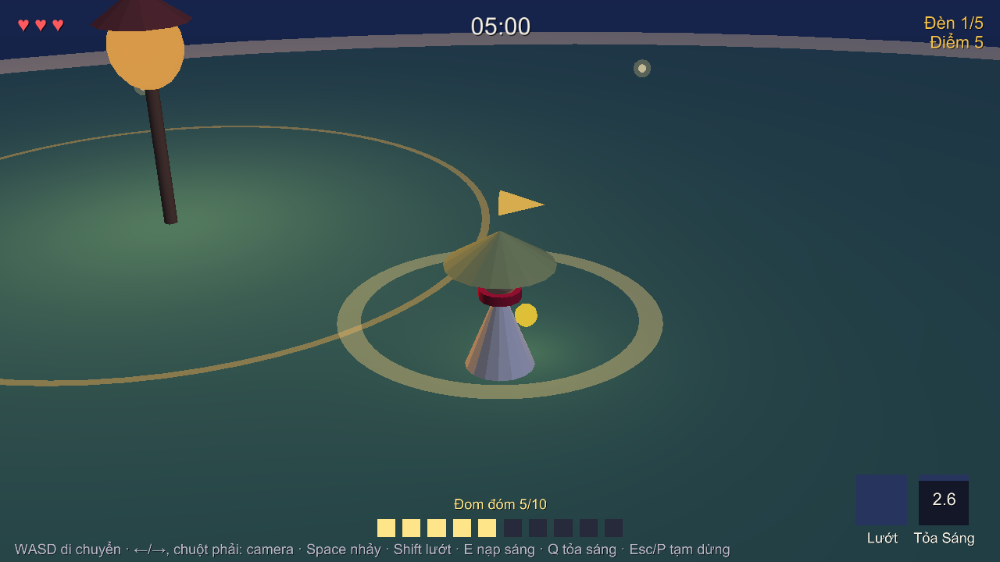

# Đảo Đèn Lồng — Day 12 AI SDLC

> 🎬 **Video demo:** sẽ đính kèm Release `v1.0.0` ở Phase 4.
> Nguyễn Hoàng · 2A202603447 · Đề bài gốc: [docs/lab/](docs/lab/README.md) · Ticket: [docs/lab/tickets/](docs/lab/tickets/)

Đảo Đèn Lồng là game 3D góc nhìn thứ ba. Người chơi điều khiển **Mây**, người giữ đèn nhỏ tuổi đội nón lá. Mây gom **đom đóm** để thắp lại các **Đèn Lồng Lớn** trên ba hòn đảo trong biển mây (Đảo Bến, Đảo Cau, Đảo Chuông), đồng thời né **Bóng Mực** và **Gió Lạc** trong sương đen.



## Cài đặt và chạy (macOS / Linux, Python ≥ 3.10)

```bash
git clone https://github.com/gauronaldo/K5-L3A-DAY12-NguyenHoang-2A202603447-AI-SDLC-Dao-Den-Long.git && cd K5-L3A-DAY12-NguyenHoang-2A202603447-AI-SDLC-Dao-Den-Long
python3 -m pip install -r requirements.txt
python3 main.py
```

Chế độ headless và test chỉ cần Python, không phải cài thêm gì. Trên Windows, gõ `python` thay cho `python3`.

## Điều khiển

| Phím | Hành động |
|---|---|
| W A S D (hoặc ↑ ↓) | Di chuyển theo hướng camera |
| ← → hoặc giữ chuột phải và kéo | Xoay camera (độ nhạy chỉnh trong Cài đặt) |
| Space | Nhảy |
| Shift | Lướt |
| E (hoặc F) | Nạp đom đóm vào Đèn Lồng Lớn gần nhất (trong 2 m) |
| Q (hoặc chuột trái) | Tỏa Sáng: tốn 3 đom đóm, làm choáng và đẩy lùi Bóng Mực trong 5 m |
| Esc / P | Tạm dừng (Tiếp tục / Chơi lại Đêm / Cài đặt / Về menu) |

## Luật chơi (số chuẩn Ticket-02)

- Có 3 Đêm: Đảo Bến (5 đèn, 300 s), Đảo Cau (6 đèn, 330 s), Đảo Chuông (7 đèn, 360 s). Thắp hết đèn thì thắng Đêm. Mất hết 3 Ngọn Lửa hoặc trời sáng mà chưa thắp hết thì thua, và được chơi lại Đêm đó.
- Mây mang tối đa 10 đom đóm. Mỗi đèn cần 10 đom đóm và nhớ số đã nạp. Đèn đã sáng tạo vùng 6 m mà Bóng Mực không vào được.
- Bóng Mực phát hiện Mây trong 12 m và bỏ đuổi khi cách xa hơn 18 m. Bị Bóng Mực chạm thì mất 1 lửa và rơi một nửa số đom đóm đang mang (nhặt lại được trong 8 s). Rơi khỏi đảo cũng mất 1 lửa và mất hết đom đóm.
- Gió Lạc (Đêm 2–3) cướp 3 đom đóm khi Mây mang từ 5 trở lên. Bùa Gió giúp chạy 7.2 m/s và lướt không hồi chiêu trong 10 s. Đêm 3 có gió mạnh mỗi 30 s.
- Điểm: +10 mỗi đom đóm nạp, +100 mỗi đèn, +5 mỗi Bóng Mực trúng Tỏa Sáng. Khi thắng một Đêm được cộng thêm 2 điểm mỗi giây còn lại và 50 điểm mỗi lửa còn lại. Tổng điểm là tổng điểm các Đêm đã thắng.

Mọi con số nằm ở [lantern/config.py](lantern/config.py) và [game.contract.json](game.contract.json). Các giả định nằm ở [phase-1](docs/notes/phase-1.md) và [phase-2](docs/notes/phase-2.md).

## Headless (Test Contract v1.1)

```bash
python3 headless.py --seed 1 --night 2 --ticks 1200 --out out.jsonl \
    [--scenario scenarios/16_drifter_steal/scenario.json] [--inputs file.json] [--snapshot-every 10]
```

- Chạy 60 tick/s, không mở cửa sổ. Lệnh dừng khi chạy đủ `--ticks` hoặc khi Đêm kết thúc (exit 0). Nếu file đầu vào sai định dạng hoặc `--night` không thuộc 1–3 thì exit 2 và ghi lỗi ra stderr.
- Một Đêm 21 600 tick chạy khoảng 1–3 giây.
- Phần tự diễn giải chỗ ticket chưa nói rõ: điểm xuất phát Đêm 3 là (0,0,−25), vì (0,0,0) nằm trong tháp chuông. `invuln` trong snapshot là boolean. Các giả định khác xem [phase-2.md §2](docs/notes/phase-2.md).

## Kiểm chứng

```bash
python3 tools/verify.py --phase phase-2       # unit test + 20 scenario (chạy 2 lần mỗi scenario) → docs/proof/phase-2/
python3 -m unittest discover -s tests          # chỉ unit test
python3 tools/screenshot.py --phase phase-2   # ảnh chụp từ client thật (offscreen)
python3 main.py --fps-probe 10 --night 3       # đo FPS ở 1280×720, có autopilot điều khiển
```

CI chạy `tools/verify.py` trên Ubuntu và macOS mỗi lần push. Bảng truy vết yêu cầu đến bằng chứng: [Phase 1](docs/proof/phase-1/README.md) · [Phase 2](docs/proof/phase-2/README.md).

## Sáng tạo của tôi

Các phần dưới đây chỉ nằm trong client, không chạm tới `lantern/sim.py`. Vì vậy output headless không thay đổi; bằng chứng là 20 scenario vẫn đạt và tất định.

- **Vòng an toàn phát sáng** 6 m quanh đèn đã sáng, giúp người chơi thấy rõ vùng Bóng Mực không vào được ([ảnh](docs/proof/phase-2/screenshots/03_night1_pulse_hud.png)).
- **Đèn tay của Mây sáng dần** theo số đom đóm đang mang.
- **La bàn** trên đầu Mây chỉ về đèn chưa sáng gần nhất.
- **Lời dẫn của Ông Đăng** riêng cho từng Đêm ([ảnh](docs/proof/phase-2/screenshots/02_intro_night1.png)).
- **Âm thanh tự tổng hợp** bằng code (nhạc nền ngũ cung và 11 hiệu ứng), không dùng asset ngoài.
- Hiệu ứng bùng sáng khi thắp đèn, vòng Tỏa Sáng lan rộng đúng 5 m, lá bay theo hướng gió.

## Cấu trúc

```text
lantern/sim.py        logic thuần, tất định, 12 bước/tick (dùng chung cho game và headless)
lantern/config.py     số chuẩn, 3 bản đồ, bảng màu   ·   lantern/world.py   mặt đất / vật cản
lantern/files.py      kiểm tra inputs/scenario         ·   lantern/headless.py CLI
lantern/client.py     client Panda3D, HUD, menu        ·   lantern/campaign.py, settings.py, meshes.py
assets/sounds/        âm thanh sinh bởi tools/gen_sounds.py
tests/, scenarios/    unit test + scenario headless (kỳ vọng tính tay)
tools/                verify.py, screenshot.py, gen_sounds.py, hooks/stop_gate.py
docs/notes/           giả định, nhật ký AI, retro    ·   docs/proof/  bằng chứng từng phase
AGENTS.md, CLAUDE.md, .claude/   harness AI (skill verify-game, Stop hook, agent reviewer)
```

## Tài liệu

[Phase 1](docs/notes/phase-1.md) · [Phase 2](docs/notes/phase-2.md) · [Nhật ký AI](docs/notes/ai-log.md) · [Đánh giá & retro](docs/notes/retro.md) · [CHANGELOG](CHANGELOG.md) · [CREDITS](CREDITS.md) · [LICENSE](LICENSE)
