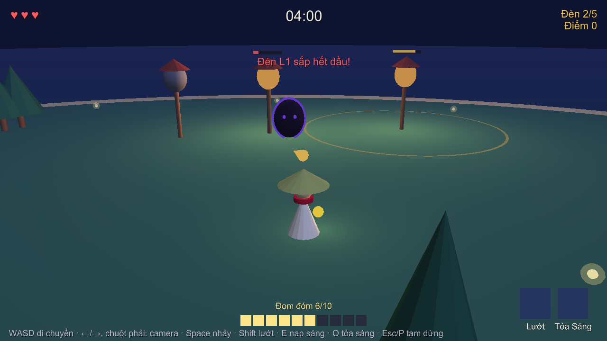

# Đảo Đèn Lồng — Day 12 AI SDLC

> 🎬 **Video demo (2:33):** [demo.mp4 trong Release v1.0.0](https://github.com/gauronaldo/K5-L3A-DAY12-NguyenHoang-2A202603447-AI-SDLC-Dao-Den-Long/releases/download/v1.0.0/demo.mp4) · bản trong repo: [docs/demo/demo.mp4](docs/demo/demo.mp4)
> 📦 **Bản chạy được:** [Release v1.0.0](https://github.com/gauronaldo/K5-L3A-DAY12-NguyenHoang-2A202603447-AI-SDLC-Dao-Den-Long/releases/tag/v1.0.0) (file thực thi Windows, không cần cài Python)
> Nguyễn Hoàng · 2A202603447 · Đề bài: [docs/lab/](docs/lab/README.md) · Ticket: [docs/lab/tickets/](docs/lab/tickets/)

Đảo Đèn Lồng là game 3D góc nhìn thứ ba. Người chơi điều khiển **Mây**, người giữ đèn nhỏ tuổi đội nón lá, đi gom **đom đóm** để thắp và châm dầu cho các **Đèn Lồng Lớn** trên ba hòn đảo giữa biển mây. Mục tiêu là giữ đảo sáng tới bình minh, đồng thời né **Bóng Mực** (chúng hút dầu đèn) và **Gió Lạc** (chúng cướp đom đóm).



## Yêu cầu hệ thống

- **Bản phát hành:** Windows 10/11 x64, card đồ hoạ hỗ trợ OpenGL 3.2; đã kèm sẵn Python và Panda3D.
- **Từ mã nguồn (Windows / macOS / Linux):** Python ≥ 3.10 và `panda3d==1.10.14`. Headless, test, soak chỉ cần Python, không cần GPU.

## Cài đặt và chạy (3 lệnh)

```bash
git clone https://github.com/gauronaldo/K5-L3A-DAY12-NguyenHoang-2A202603447-AI-SDLC-Dao-Den-Long.git && cd K5-L3A-DAY12-NguyenHoang-2A202603447-AI-SDLC-Dao-Den-Long
python3 -m pip install -r requirements.txt
python3 main.py
```

**Windows không cần cài gì:** tải `DaoDenLong-1.0.0-windows-x64.zip` trong [Release v1.0.0](https://github.com/gauronaldo/K5-L3A-DAY12-NguyenHoang-2A202603447-AI-SDLC-Dao-Den-Long/releases/tag/v1.0.0), giải nén, chạy `DaoDenLong.exe`. Khi chạy từ mã nguồn trên Windows, gõ `python` thay cho `python3`.

## Điều khiển (đổi được trong Cài đặt → Phím điều khiển)

| Phím mặc định | Hành động |
|---|---|
| W A S D | Di chuyển theo hướng camera |
| ← → hoặc giữ chuột phải và kéo | Xoay camera |
| Space / Shift | Nhảy / Lướt |
| E | Nạp đom đóm vào đèn tắt hoặc châm dầu cho đèn đang sáng (trong 2 m) |
| Q hoặc chuột trái | Tỏa Sáng: tốn 3 đom đóm, làm choáng và đẩy lùi Bóng Mực trong 5 m |
| P hoặc Esc | Tạm dừng (Tiếp tục / Chơi lại Đêm / Cài đặt / Về menu) |

**Cài đặt** (được lưu lại): âm lượng, độ nhạy chuột, bảng màu dễ phân biệt (cho người mù màu), giảm chuyển động, chữ lớn ×1.25, đổi phím (có báo khi trùng phím và nút khôi phục mặc định). Menu chính có **Bảng xếp hạng** top 10. Sau Bình Minh hoặc khi thua có thể nhập tên để lưu điểm.

## Luật chơi

- Có 3 Đêm: Đảo Bến (5 đèn, 240 s), Đảo Cau (6 đèn, 270 s), Đảo Chuông (7 đèn, 300 s). Đến bình minh phải còn sáng ít nhất 3/5, 4/6 hoặc 5/7 đèn thì mới thắng Đêm. Hết 3 Ngọn Lửa thì thua ngay.
- Thắp đèn lần đầu cần 10 đom đóm, thắp lại chỉ cần 5. Đèn đang sáng hao 1 dầu mỗi giây; châm thêm được 10 dầu cho mỗi đom đóm. Đèn có từ 30 dầu trở lên thì có vùng an toàn bán kính 6 m. Đèn yếu hơn sẽ bị Bóng Mực tới hút dầu.
- Sức chứa đom đóm = 10 + 2 × số lần thắp thành công, tối đa 20. Bóng Mực phát hiện Mây trong 12 m. Bị chạm thì mất 1 lửa và rơi một nửa số đom đóm đang mang. Rơi khỏi đảo cũng mất 1 lửa.
- Điểm: mỗi đom đóm nạp +5; thắp lần đầu +100; thắp lại +40; Tỏa Sáng trúng Bóng Mực +5, hoặc +15 nếu nó đang hút dầu. Khi thắng một Đêm: mỗi đèn còn sáng +50 + số dầu còn lại, mỗi lửa còn lại +50. Tổng điểm là tổng điểm các Đêm đã thắng.

Mọi con số nằm ở [lantern/config.py](lantern/config.py) và [game.contract.json](game.contract.json). Thiết kế đèn có dầu được giải thích trong [ADR 0001](docs/adr/0001-lantern-fuel-and-dawn-win.md).

## Chạy test và kiểm chứng

```bash
python3 tools/verify.py --phase phase-4   # 99 unit test + 25 scenario headless (mỗi scenario chạy 2 lần để kiểm tra tất định)
python3 -m unittest discover -s tests      # chỉ chạy unit test
python3 tools/screenshot.py --phase phase-4   # chụp ảnh từ client thật (offscreen)
```

CI chạy `verify.py` trên Ubuntu và macOS mỗi lần push. Workflow `release-smoke` tải bản Windows trong Release về một máy Windows sạch và chạy thử. Bảng truy vết từ yêu cầu tới bằng chứng: [Phase 1](docs/proof/phase-1/README.md) · [Phase 2](docs/proof/phase-2/README.md) · [Phase 3](docs/proof/phase-3/README.md) · [Phase 4](docs/proof/phase-4/README.md).

## Headless (Test Contract v1.3)

```bash
python3 headless.py --seed 1 --night 2 --ticks 1200 --out out.jsonl [--scenario file.json] [--inputs file.json] [--snapshot-every 10]
```

Logic chạy 60 tick/s, không mở cửa sổ. Một Đêm 21 600 tick chạy trong khoảng 1–3 s. File đầu vào sai định dạng hoặc `--night` không thuộc 1–3 thì trả exit 2 kèm thông báo trên stderr. Các giả định cho chỗ ticket chưa nói rõ ghi ở [phase-1](docs/notes/phase-1.md) … [phase-4](docs/notes/phase-4.md).

## Benchmark

```bash
python3 main.py --bench --seed 42 --duration 30 --out bench.json
```

Bench mở cửa sổ 1280×720, tắt vsync, dựng cảnh Đêm 1 với 200 Bóng Mực và 100 đom đóm, camera bay vòng quanh. Chạy khởi động 3 s, sau đó đo 30 s rồi tự thoát. Kết quả trên RTX 4060: **103 FPS trung bình, 68.8 FPS ở 1% khung chậm nhất, tải xong trong 2.1 s** ([bench.json](docs/proof/phase-4/bench.json); lịch sử các lần đo ghi ở [proof Phase 4](docs/proof/phase-4/README.md)).

## Soak test

```bash
python3 soak.py --seed 7 --nights 10 --out soak.json
```

Chạy liên tiếp 10 Đêm (1→2→3 xoay vòng) trong cùng một tiến trình, với input ngẫu nhiên theo seed. Kết quả: 0 crash, RAM 25.3 → 26.0 MB ([soak.json](docs/proof/phase-4/soak.json)).

## Sáng tạo của tôi

Các phần dưới đây chỉ nằm trong client, không đổi output headless (25 scenario vẫn đạt và cho kết quả giống hệt mỗi lần chạy). Trong cảnh bench, la bàn và vòng an toàn được tắt.

- **Vòng an toàn phát sáng** quanh đèn còn vùng an toàn (tắt khi dầu < 30) và **la bàn** chỉ về đèn chưa sáng gần nhất.
- **Đèn tay của Mây sáng dần** theo số đom đóm đang mang. **Lời dẫn của Ông Đăng** riêng cho từng Đêm.
- **Âm thanh tự tổng hợp bằng code**: nhạc nền ngũ cung và 11 hiệu ứng, không dùng asset ngoài.
- Hiệu ứng bùng sáng khi thắp đèn, vòng Tỏa Sáng lan rộng đúng 5 m, lá bay theo hướng gió.

## Cấu trúc

```text
lantern/sim.py        logic thuần, tất định, 12 bước mỗi tick (dùng chung cho game, headless, bench, soak)
lantern/config.py     số chuẩn, 3 bản đồ, bảng màu  ·  world.py mặt đất/vật cản  ·  files.py kiểm tra input
lantern/client.py     client Panda3D: HUD, menu, cài đặt, bench  ·  meshes.py mô hình dựng bằng code
lantern/bench_scene.py, soak.py, leaderboard.py, settings.py, campaign.py, sysinfo.py   (Python thuần)
headless.py · soak.py · main.py · setup.py (build_apps)
tests/, scenarios/    unit test + scenario headless (kỳ vọng tính tay, lý do ghi trong "why")
tools/                verify.py, screenshot.py, gen_sounds.py, make_demo.py, package_release.py, hooks/
docs/notes/ giả định, nhật ký AI, retro · docs/proof/ bằng chứng · docs/adr/ quyết định · docs/demo/ video
AGENTS.md, CLAUDE.md, .claude/   harness AI (skill verify-game, Stop hook, agent reviewer)
```

## Tài liệu

[Giả định P1](docs/notes/phase-1.md) · [P2](docs/notes/phase-2.md) · [P3](docs/notes/phase-3.md) · [P4](docs/notes/phase-4.md) · [ADR](docs/adr/) · [Nhật ký AI](docs/notes/ai-log.md) · [Retro](docs/notes/retro.md) · [CHANGELOG](CHANGELOG.md) · [CREDITS](CREDITS.md) · [LICENSE](LICENSE)
