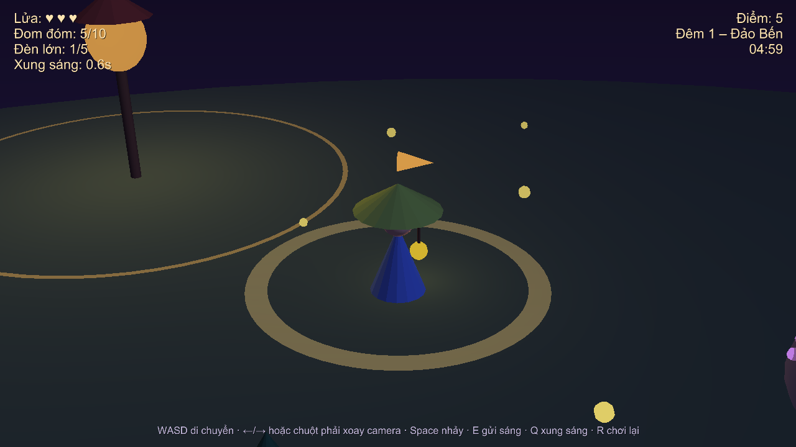

# Đảo Đèn Lồng — Day 12 AI SDLC

> 🎬 **Video demo:** sẽ đính kèm Release `v1.0.0` ở Phase 4 (chưa có ở tag `phase-1`).
> Nguyễn Hoàng · 2A202603447 · Đề bài gốc: [docs/lab/](docs/lab/README.md)

Game 3D góc nhìn thứ ba. **Mây**, người giữ đèn nhỏ tuổi đội nón lá, gom **đom đóm** để thắp lại **5 Đèn Lồng Lớn** của Đảo Bến và né **Bóng Mực** trong sương đen trước khi trời sáng.



## Cài đặt và chạy (macOS / Linux, Python ≥ 3.10)

```bash
git clone https://github.com/gauronaldo/K5-L3A-DAY12-NguyenHoang-2A202603447-AI-SDLC-Dao-Den-Long.git && cd K5-L3A-DAY12-NguyenHoang-2A202603447-AI-SDLC-Dao-Den-Long
python3 -m pip install -r requirements.txt
python3 main.py
```

Chế độ headless và test **không cần** cài gì thêm (chỉ thư viện chuẩn Python). Windows: dùng `python` thay `python3`.

## Điều khiển

| Phím | Hành động |
|---|---|
| W A S D (hoặc ↑ ↓) | Di chuyển theo hướng camera |
| ← → / giữ chuột phải + kéo | Xoay camera |
| Space | Nhảy |
| E (hoặc F) | Gửi đom đóm vào Đèn Lồng Lớn gần nhất (trong 2.5 m) |
| Q (hoặc chuột trái) | Xung sáng: tốn 1 đom đóm, đẩy lùi + làm choáng Bóng Mực trong 6 m |
| Enter | Bắt đầu · **R** chơi lại · Esc thoát |

## Luật & điểm (Đêm 1 – Đảo Bến)

- Mang tối đa 10 đom đóm; mỗi đèn cần 5. Thắp đủ 5 đèn → **thắng**. Hết 3 ngọn lửa hoặc hết 300 s (bình minh) → **thua**.
- Bóng Mực đuổi theo (3.5 m/s, chậm hơn Mây 6 m/s), chạm → mất 1 lửa, rơi một nửa số đom đóm đang mang, bất tử 1.5 s. Bóng Mực **không vào được vòng 5 m quanh mọi đèn**. Cứ 45 s thêm một Bóng Mực (tối đa 6).
- Điểm: +10 mỗi đom đóm nhặt · +100 mỗi đèn thắp · +5 mỗi Bóng Mực bị choáng · khi thắng: +1 mỗi giây còn lại, +50 mỗi lửa còn lại.

Mọi con số nằm ở [lantern/config.py](lantern/config.py) và [game.contract.json](game.contract.json). Giả định cho các chỗ PRD mơ hồ: [docs/notes/phase-1.md](docs/notes/phase-1.md).

## Headless (Test Contract v1.0)

```bash
python3 headless.py --seed 1 --night 1 --ticks 600 --out out.jsonl \
    [--scenario scenarios/04_pulse_stun_push/scenario.json] [--inputs scenarios/04_pulse_stun_push/inputs.json] [--snapshot-every 10]
```

- 60 tick/s cố định, không mở cửa sổ; dừng khi đủ `--ticks` hoặc khi thắng/thua (exit 0). File inputs/scenario hỏng → exit 2 + thông báo ở stderr.
- Khái niệm không có trong game: **rơi khỏi đảo** → `fall_enabled: false` (Mây bị chặn ở mép đảo, không bao giờ có event `player_hit` với `by: "fall"`). Không dùng `dash`. Không có giá trị `null` trong `tuning`.
- Snapshot có thêm mảng `motes` (khuyến nghị trong contract). Shade có 2 trạng thái: `chase`, `stunned`.

## Kiểm chứng

```bash
python3 tools/verify.py          # unit test + 8 scenario headless (mỗi cái chạy 2 lần so tất định) → docs/proof/phase-1/
python3 -m unittest discover -s tests   # chỉ unit test
python3 tools/screenshot.py      # ảnh từ client thật (offscreen) → docs/proof/phase-1/screenshots/
```

CI chạy `tools/verify.py` trên Ubuntu và macOS mỗi lần push ([.github/workflows/verify.yml](.github/workflows/verify.yml)).
Bảng truy vết yêu cầu → bằng chứng: **[docs/proof/phase-1/README.md](docs/proof/phase-1/README.md)**.

## Sáng tạo của tôi

Tất cả chỉ nằm trong client ([lantern/client.py](lantern/client.py)), không chạm vào `lantern/sim.py` nên **output headless không đổi** (8 scenario và hash trong [verify-report](docs/proof/phase-1/verify-report.md) giữ nguyên khi chạy không có client).

- **Vòng an toàn phát sáng** quanh mỗi Đèn Lồng Lớn — cho người chơi thấy vùng 5 m Bóng Mực không vào được (mờ tím khi đèn tắt, vàng ấm khi đèn sáng). Ảnh: [02](docs/proof/phase-1/screenshots/02_gameplay_pulse.png).
- **Đèn nhỏ của Mây sáng dần** theo số đom đóm đang mang (kích thước + ánh sáng điểm).
- **Mũi tên la bàn** trên đầu Mây chỉ tới đèn chưa thắp gần nhất.
- Đèn thắp lên có hiệu ứng bùng sáng; xung sáng có vòng lan rộng đúng bán kính 6 m; trúng đòn thì nhân vật nhấp nháy + màn hình chớp tím.

## Cấu trúc

```text
lantern/sim.py        logic thuần, tất định (dùng chung game + headless)
lantern/config.py     tuning, điểm, hằng số bố cục
lantern/files.py      đọc + kiểm tra inputs/scenario (lỗi → exit 2)
lantern/headless.py   CLI Test Contract
lantern/client.py     client 3D Panda3D + HUD   ·   lantern/meshes.py  mô hình dựng bằng code
tests/                unit test (luật game + CLI)
scenarios/            scenario headless + kỳ vọng
tools/                verify.py, screenshot.py, hooks/stop_gate.py
docs/notes/           giả định từng phase, nhật ký AI, retro
docs/proof/           bằng chứng từng phase
AGENTS.md, CLAUDE.md, .claude/   harness AI (skill verify-game, Stop hook, agent reviewer)
```

## Tài liệu

[Giả định Phase 1](docs/notes/phase-1.md) · [Bằng chứng Phase 1](docs/proof/phase-1/README.md) · [Nhật ký AI](docs/notes/ai-log.md) · [Đánh giá & retro](docs/notes/retro.md) · [CHANGELOG](CHANGELOG.md) · [CREDITS](CREDITS.md) · [LICENSE](LICENSE)
